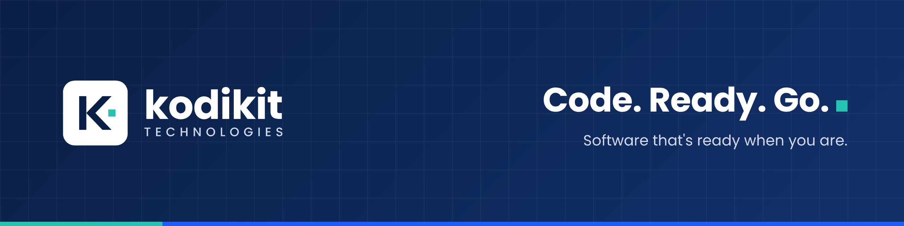

  

  
  
  
  

## Hello, world. We're Kodikit.

**Kodikit Technologies** builds ready-made software and custom digital products for businesses worldwide.
Our products are clean, reliable and ready to launch, so you can move faster.

> **Kodikit = Code + Kit.** A complete toolkit of software, ready when you are.

## What we build

| | |
|---|---|
| **Ready-made Scripts** | Launch-ready Laravel products you can install and run today |
| **Web Applications** | Fast, secure web apps built on modern, proven stacks |
| **Custom Development** | Software shaped around how your business actually works |
| **Admin Panels & Dashboards** | Clean tools to manage your data, users and team |
| **Install & Support** | Setup, updates and help from the people who wrote the code |

## Our stack

  
  
  
  
  
  
  

## Products

| Product | Description | Links |
|---|---|---|
| *Coming soon* | Our first CodeCanyon release is on the way | Follow this page for updates |

<!-- Add each product as a new row, for example:
| **Product Name** | One line about what it does | [Demo](https://demo.kodikit.com) · [Buy](https://codecanyon.net/item/...) · [Docs](https://docs.kodikit.com) |
-->

## Why Kodikit?

- **Clean code:** well structured, documented and easy to extend
- **Modern design:** responsive, fast and polished out of the box
- **Quick setup:** clear installation guides, up and running in minutes
- **Honest support:** regular updates and real help when you need it

## Work with us

Need a ready-made product or something built from scratch?
Email **[hello@kodikit.com](mailto:hello@kodikit.com)** or visit **[kodikit.com](https://kodikit.com)**.

<b>Kodikit Technologies</b> · Code. Ready. Go.

